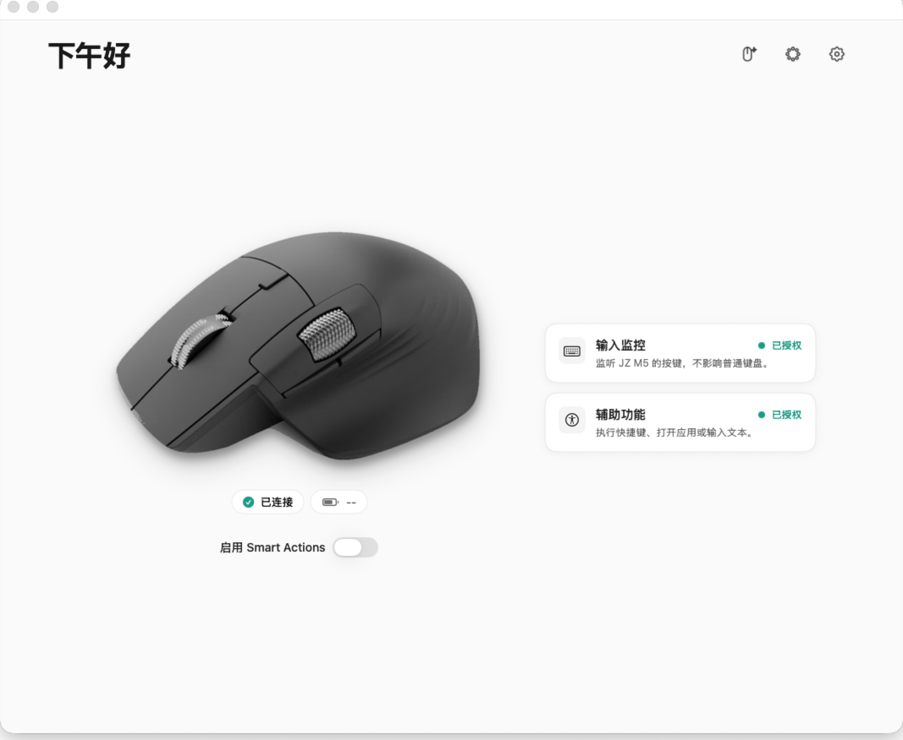

# KeyFlow

KeyFlow 是一款开源的 macOS 鼠标效率工具，让京东京造 JZ M5 在 2.4G 接收器模式下支持类似 Logi Options+ 的 Smart Actions 与 Actions Ring。

它使用 SwiftUI、AppKit 和 IOKit，直接在 Mac 上监听设备输入并执行自动化动作，不需要常驻网页驱动。



## 功能

### Smart Actions

- 支持中键、前进侧键和后退侧键。
- 支持单击、双击和长按。
- 通过可视化鼠标示意图与分段控件设置触发方式。
- 多动作按顺序执行，支持排序、启停和运行测试。
- 动作类型：
  - 键盘快捷键
  - 打开应用、文件或文件夹
  - 打开网址
  - 输入文本
  - 运行 macOS 快捷指令
  - 执行 AppleScript
  - 等待
  - 打开 Actions Ring


### Actions Ring

- 将已有 Smart Action 作为 Ring 操作位，不复制规则数据。
- 最多 8 个操作位，按实际数量均分。
- 支持搜索、拖入、替换、移除、排序、撤销和重做。
- 非激活桌面浮层，不抢占当前应用焦点。
- 支持中心关闭、外部点击和 Esc 取消。
- 支持屏幕边缘避让与多显示器定位。
- 通过包含“打开 Actions Ring”动作的规则打开，不占用固定默认按键。


### 电量与配置

- 在 2.4G 模式下读取真实电量和充电状态。
- 首页与菜单栏同步显示电量。
- 启动时查询，之后每 60 秒自动刷新。
- 低电量警告；未读到时显示 `--`，未连接时不显示电量。
- 配置保存在本机，自动保存并支持导入、导出。
- 删除和覆盖导入需要确认。

## 系统要求

- macOS 13 或更高版本。
- Apple Silicon Mac；当前构建脚本生成 arm64 应用。
- 京东京造 JZ M5，使用 2.4G 接收器连接。
- 需要“输入监控”和“辅助功能”权限。

## 下载与使用

从项目的 Releases 页面下载最新版本，解压后打开 `KeyFlow.app`。

首次启动时：

1. 使用 2.4G 接收器连接 JZ M5。
2. 在首页完成“输入监控”和“辅助功能”授权。
3. 打开“启用 Smart Actions”。
4. 进入 Smart Actions，新建规则并设置按键、触发方式和动作。
5. 使用“运行测试”验证，然后关闭窗口；KeyFlow 会继续在菜单栏运行。

完整说明见 [使用说明](Docs/使用说明.md)。

## 从源码构建

需要 macOS 13+ 和 Xcode Command Line Tools，不需要完整 Xcode。

```bash
git clone https://github.com/daxiangwork/KeyFlow.git
cd KeyFlow
swift build
./Scripts/package-app.sh
open dist/KeyFlow.app
```

打包脚本会优先使用 `CODE_SIGN_IDENTITY` 指定的签名身份；本机存在 `KeyFlow Local Development` 时使用该稳定身份，否则使用 ad-hoc 签名。稳定签名有助于避免每次重新构建后重复授权。

## 隐私与安全

- 规则与 Ring 配置只保存在本机 `~/Library/Application Support/KeyFlow/`。
- 没有账号、云同步、广告或分析服务。
- KeyFlow 只拦截刚刚由 JZ M5 产生的匹配事件，不全局拦截普通键盘的复制、粘贴。
- 只有用户主动创建并执行的自动化动作才会运行。

## 当前限制

- 主要适配 JZ M5 的 2.4G 接收器，不把蓝牙模式作为已验证能力。
- DPI、回报率、板载宏和其他硬件设置仍由京造网页驱动负责。
- DPI 键当前不能作为 Smart Action 触发器。
- 不包含应用专属配置、手势、插件、文件夹或云同步。

## 致谢

JZ M5 电量 HID 适配参考了 [LANMIN-X/Jingzao-JZM5-Battery](https://github.com/LANMIN-X/Jingzao-JZM5-Battery)。相关许可证说明包含在 `Resources/ThirdPartyNotices.txt`。

## 许可证

KeyFlow 使用 [MIT License](LICENSE)。
