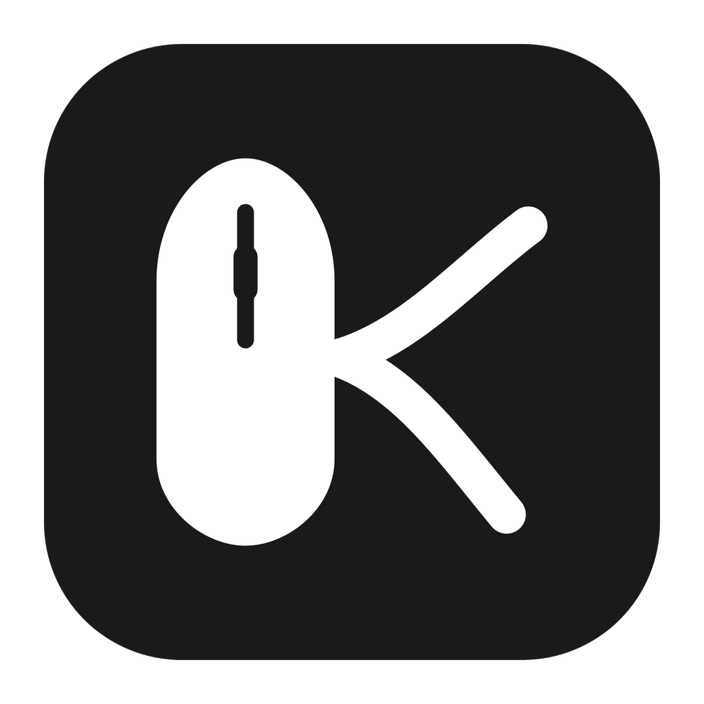
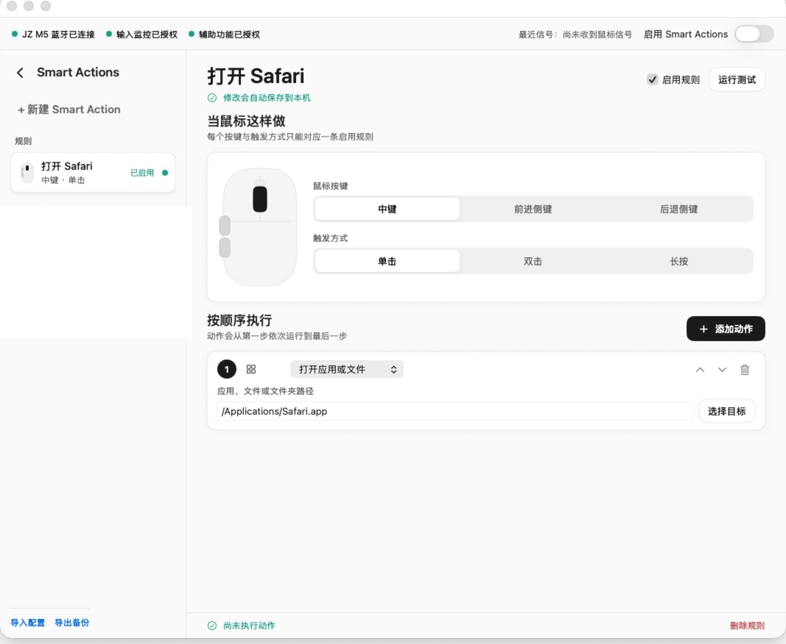
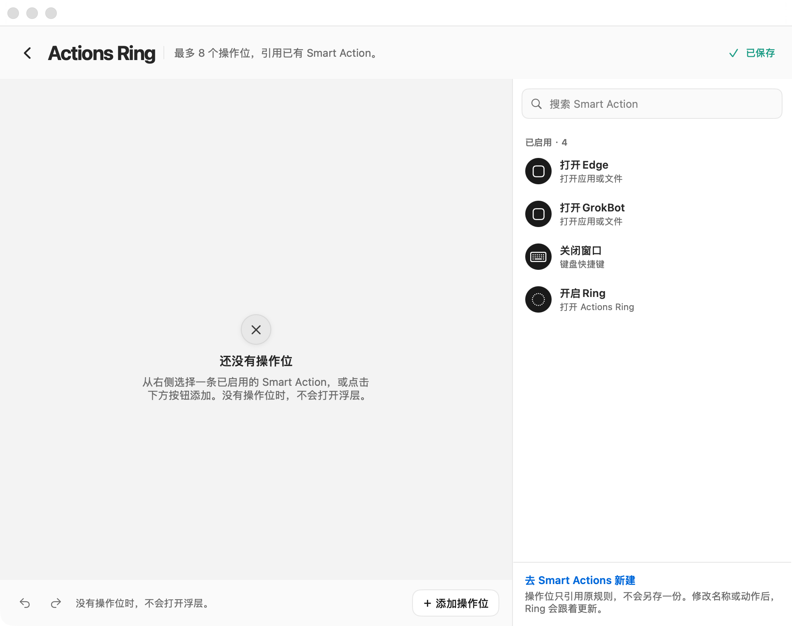

<div align="center">
  

  # KeyFlow

  **让京造 JZ M5 在 macOS 上拥有自然、高效的自动化工作流。**

  Smart Actions · Actions Ring · 真实电量 · 本地配置

  <p>
    
    
    
    
  </p>

  [功能特性](#功能特性) · [快速开始](#快速开始) · [从源码构建](#从源码构建) · [项目文档](#项目文档) · [参与贡献](#参与贡献)
</div>

---

## 一个按键，完成更多工作

KeyFlow 是一款开源的 macOS 菜单栏工具，让京东京造 **JZ M5** 通过蓝牙、有线或 2.4G 接收器连接时支持类似 Logi Options+ 的 Smart Actions 与 Actions Ring。

不需要常驻网页驱动。KeyFlow 直接在 Mac 上识别鼠标输入，执行你定义的快捷键、应用启动、文本输入和多步工作流。

<p align="center">
  
  <br>
  <sub>首页集中显示设备连接、权限状态、真实电量和 Smart Actions 总开关。</sub>
</p>

## 功能特性

### Smart Actions：把重复流程交给一个按键

为不同鼠标按键安排单击、双击或长按，让多个动作按顺序执行。

- 支持中键、前进侧键和后退侧键。
- 通过鼠标示意图和分段控件设置触发方式。
- 多动作排序、启停、冲突检查和运行测试。
- 修改自动保存，支持配置导入与导出。
- 所有执行状态都在当前页面就地反馈。

支持的动作：

| 类别 | 动作 |
| --- | --- |
| 输入与控制 | 键盘快捷键、输入文本 |
| 打开目标 | 应用、文件、文件夹、网址 |
| macOS 自动化 | 快捷指令、AppleScript |
| 工作流控制 | 等待、打开 Actions Ring |

<p align="center">
  
</p>

### Actions Ring：在光标旁选择下一步

把已有 Smart Action 或 KeyFlow 系统预设操作放入一个轻量桌面浮层，需要时再选择执行。

- 最多 8 个操作位，按实际数量均分。
- 使用规则 UUID 或系统操作 ID 引用原操作，不创建重复副本。
- 支持系统操作 / Smart Actions Tab、媒体和音量预设、搜索、拖入、替换、移除、排序、撤销和重做。
- 非激活浮层，不抢占原应用焦点。
- 支持中心关闭、外部点击与 Esc 取消。
- 支持屏幕边缘避让和多显示器定位。

Ring 不占用固定的默认按键。只需在任意规则中添加 **“打开 Actions Ring”** 动作，即可按你的习惯触发。

<p align="center">
  
</p>

### 真实电量与本地配置

- 在 2.4G 模式下读取真实电量和充电状态。
- 首页与菜单栏同步显示，每 60 秒自动刷新。
- 低电量警告；未读到时显示 `--`，未连接时隐藏。
- 规则与 Ring 配置只保存在本机。
- 没有账号、云同步、广告或分析服务。

## 快速开始

### 系统要求

- macOS 13 或更高版本
- Apple Silicon Mac
- 京东京造 JZ M5，通过蓝牙、有线或 2.4G 接收器连接

### 安装与配置

1. 从项目 Releases 下载最新版本，解压后打开 `KeyFlow.app`。
2. 在首页完成 **输入监控** 和 **辅助功能** 授权。
3. 打开 **启用 Smart Actions**。
4. 新建规则，设置触发按键、触发方式和动作。
5. 使用“运行测试”验证。关闭窗口后，KeyFlow 会继续在菜单栏运行。

详细操作与故障排查请阅读 [使用说明](Docs/使用说明.md)。

## 从源码构建

需要 macOS 13+ 和 Xcode Command Line Tools，**不需要完整 Xcode**。

```bash
git clone https://github.com/daxiangwork/KeyFlow.git
cd KeyFlow
swift build
./Scripts/package-app.sh
open dist/KeyFlow.app
```

打包脚本优先使用 `CODE_SIGN_IDENTITY` 指定的签名身份；本机存在 `KeyFlow Local Development` 时使用该稳定身份，否则使用 ad-hoc 签名。稳定签名可以避免普通重新构建后反复授权。

## 项目文档

| 文档 | 内容 |
| --- | --- |
| [使用说明](Docs/使用说明.md) | 安装、授权、规则、Ring、电量、备份与故障排查 |
| [UI 设计规范](Docs/DesignSystem.md) | 色彩、字体、组件、页面结构与状态 |
| [Actions Ring 早期设计草案](Docs/KeyFlow-ActionsRing-UI-Requirements.md) | 功能演进与设计过程参考 |
| [第三方许可证说明](Resources/ThirdPartyNotices.txt) | 电量协议参考项目与 MIT 许可证 |

## 隐私与产品边界

KeyFlow 只拦截刚刚由 JZ M5 产生的匹配事件，不全局拦截普通键盘的复制、粘贴。只有用户主动创建并执行的自动化动作才会运行。

Smart Actions 与 Actions Ring 已支持 **JZ M5 蓝牙、有线和 2.4G 连接**；电量读取目前仅支持 2.4G 模式。以下能力不在当前范围内：

- DPI、回报率、板载宏和固件更新等硬件设置；
- 蓝牙和有线模式的电量读取；
- DPI 键作为 Smart Action 触发器；
- 应用专属配置、手势、插件、文件夹和云同步。

## 参与贡献

欢迎通过 Issues 报告兼容性问题、交互缺陷或提出改进建议。提交代码前，建议先在 Issue 中说明复现环境、JZ M5 连接方式和 macOS 版本。

## 致谢

JZ M5 电量 HID 适配参考了 [LANMIN-X/Jingzao-JZM5-Battery](https://github.com/LANMIN-X/Jingzao-JZM5-Battery)，相关许可证说明已包含在项目中。

## 许可证

KeyFlow 使用 [MIT License](LICENSE)。

<div align="center">
  <br>
  <sub>KeyFlow · 为 JZ M5 打造的 macOS 效率工具</sub>
</div>
